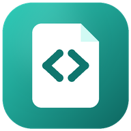

# HTML 打开器

仓库：<https://github.com/PengWang88/html-opener>

一个最小化的 Android 应用，用来打开本地 Web 应用，并提供快捷链接：

1. 点击右上角「导入」，选择一个包含多个 Web 应用子文件夹的目录。应用只记录该目录的访问授权（引用导入），不复制任何文件。
2. 点击列表中的子文件夹，用手机上的浏览器打开对应的 Web 应用。系统弹窗会提供「仅一次 / 始终」。
3. 底部切换到「02 链接」，可以添加、编辑、删除常用网址，点击直接用浏览器打开。

## 安装

发布版 APK：[HTMLOpener-release.apk](HTMLOpener-release.apk)（已签名）
调试版可通过 `./gradlew assembleDebug` 本地构建。

发布版使用独立签名，与调试版签名不同：

**从 v1.3–v1.6 发布版升级**（同一签名，保留已导入目录和快捷链接）：

```bash
adb install -r HTMLOpener-release.apk
```

**从调试版或其他签名版本切换**（必须先卸载，已导入目录会清除）：

```bash
adb uninstall com.example.htmlopener
adb install HTMLOpener-release.apk
```

也可以把 APK 传到手机上点击安装；签名不一致时系统会提示先卸载旧版本。

- 包名：`com.example.htmlopener`
- 最低系统：Android 6.0（API 23）
- 目标系统：Android 14（API 34）
- 版本：1.7（versionCode 8）
- 发布 APK 大小：约 113 KB
- 发布 APK SHA-256：`1233b81174b38bdef3753b39176b6b5731f77aa8d6b7a7ce89ad6d5e56fcafd8`

## 界面

- 瑞士国际主义风格：纯白、黑、红三色，大字号标题，编号列表，细线分隔，无圆角卡片。
- 底部双标签导航：`01 应用` / `02 链接`，红色顶部指示条标识当前页。
- 应用页显示序号（01、02…）、应用名和入口文件；链接页显示名称和网址；空状态使用大号“00”和引导文字。
- 应用图标为红底白色 `<>` 标记，包含自适应图标、圆形图标和旧版 PNG。



## 目录结构约定

选择一个父目录，**每个一级子文件夹就是一个 Web 应用**：

```text
选择的父目录/
├── app-one/
│   ├── index.html      ← 入口，存在时优先打开
│   ├── style.css
│   └── js/app.js
├── app-two/
│   ├── index.html
│   └── assets/...
└── index.html          ← 可选：父目录自身也会显示为一个应用
```

规则：

- 子文件夹内有 `index.html` 或 `index.htm` 时，点击该子文件夹打开它。
- 没有 index 时，打开该子文件夹内按名称排序的第一个 `.html` / `.htm`。
- 只扫描一级子文件夹；子文件夹内部的 JS/CSS/图片等资源不受目录层级限制，均可加载。
- 如果所选父目录自身包含 `index.html`，父目录也会显示为一个应用。
- 如果某个子文件夹内没有 HTML，则不会出现在列表中。

## 快捷链接

- 底部导航切到「02 链接」。
- 点右上角「添加 +」，输入名称和网址；网址不写 `https://` 也可以，会自动补全。
- 点击条目直接用浏览器打开。
- 点条目右侧「编辑」可以修改名称/网址，也可以删除。
- 链接保存在应用本地 `SharedPreferences` 中，不会上传到网络。

## 浏览器选择

- 本地 Web 应用按 `text/html` 类型打开，不固定某个浏览器。
- 应用会查询系统当前打开本地 HTML 文件（`file` / `content` + `text/html`）的默认应用，并把本地 `http://127.0.0.1:...` 地址直接交给它。这样它和本地 HTML 文件使用同一个软件，通常是 Chrome。
- 如果系统没有设置默认 HTML 应用，则走系统选择器，可再次选择「仅一次 / 始终」。
- 快捷链接不受此限制，仍按系统默认应用打开；指向 PWA 的链接会正常交给那个 PWA。
- 如果升级后仍被 PWA 接管，说明系统把那个 PWA 设成了 HTML 或 http 的默认应用，需要在系统「默认应用」设置里清除默认，或重新选择 Chrome 并点「始终」。

## 为什么用本地 HTTP 服务

浏览器无法直接读取应用私有目录中的文件，也无法通过单个 `content://` 授权解析 HTML 里的相对路径 JS/CSS。

因此应用引用 HTML 所在目录，并在 `127.0.0.1` 上启动一个临时静态文件服务：

```text
http://127.0.0.1:<随机端口>/t/<随机令牌>/app-one/index.html
```

这样以父目录为网站根目录，`app-one/style.css`、`app-one/js/app.js`、甚至 `../shared/...` 都能正确加载；修改原文件后刷新浏览器即可看到变化。随机端口和随机路径令牌降低被其他应用读取的风险。

说明：

- 需要把所选父目录理解为网站根目录；`../` 跳出该父目录的引用无法访问。
- 浏览器和本应用是分开的进程。打开页面时应用会启动一个低优先级的前台服务，避免浏览器在前台时本应用进程被系统回收；把应用从最近任务中划掉后服务会停止。Android 13 及以上若未授予通知权限，通知可能不显示在通知栏，但服务仍会运行。
- 文件夹授权会被持久保存，重启应用后仍然有效；如果原文件夹被移动/删除，需要重新导入。
- 如果页面刷新时仍提示连接被拒绝，请回到应用重新点击一次文件。

## 重新构建

需要 JDK 17 和 Android SDK（compileSdk 35）：

```bash
export JAVA_HOME=/path/to/jdk17
export ANDROID_HOME=/path/to/android-sdk

./gradlew assembleDebug    # 调试版
./gradlew assembleRelease  # 发布版（需要 keystore.properties）
```

产物：

- 调试版：`app/build/outputs/apk/debug/app-debug.apk`
- 发布版：`app/build/outputs/apk/release/app-release.apk`

## 发布签名

- 密钥库：`release.keystore`（PKCS12，别名 `htmlopener`，RSA 2048，有效期 10000 天）
- 签名配置：`keystore.properties`（包含密码，已加入 `.gitignore`，不要提交到公开仓库）
- 证书 SHA-256：`06f86bec15f725eea955a18f8138daf646a668d28f3c78dc2fc6c8d1b32eeccc`

请把 `release.keystore` 和 `keystore.properties` 离线备份。以后发布更新必须使用同一签名；丢失后无法覆盖安装旧版本，只能卸载重装或更换包名。

## 主要文件

- `app/src/main/java/com/example/htmlopener/MainActivity.java`：目录导入、Web 应用列表、快捷链接、底部导航
- `app/src/main/java/com/example/htmlopener/HtmlServer.java`：仅监听 `127.0.0.1` 的静态文件服务
- `app/src/main/java/com/example/htmlopener/ServerService.java`：保持服务进程存活的前台服务
- `app/src/main/res/layout/activity_main.xml`：页面容器和底部导航
- `app/src/main/res/layout/page_apps.xml`、`page_links.xml`：应用页、链接页
- `app/src/main/res/layout/item_app.xml`、`item_link.xml`、`dialog_link.xml`：列表行和链接对话框
- `app/src/main/res/values/colors.xml`、`styles.xml`：红黑白配色与主题
